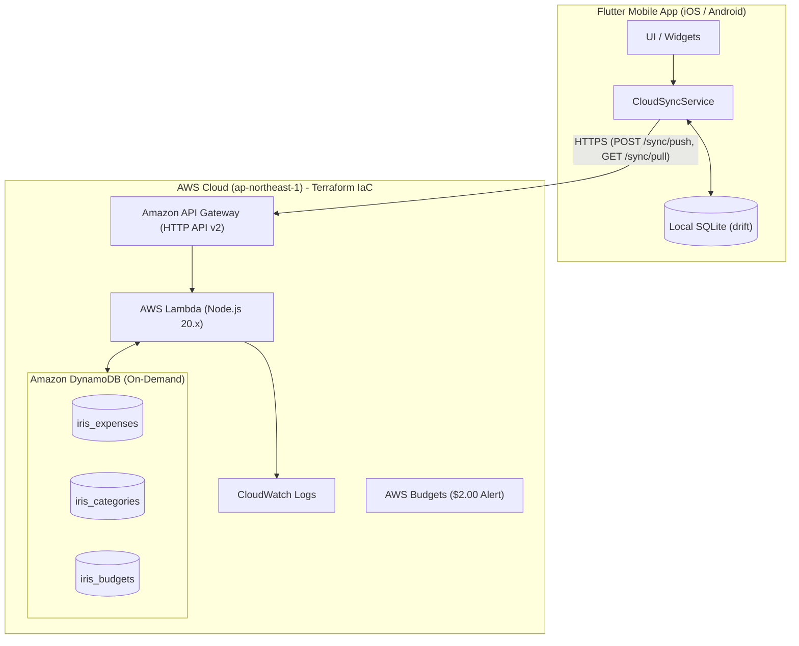
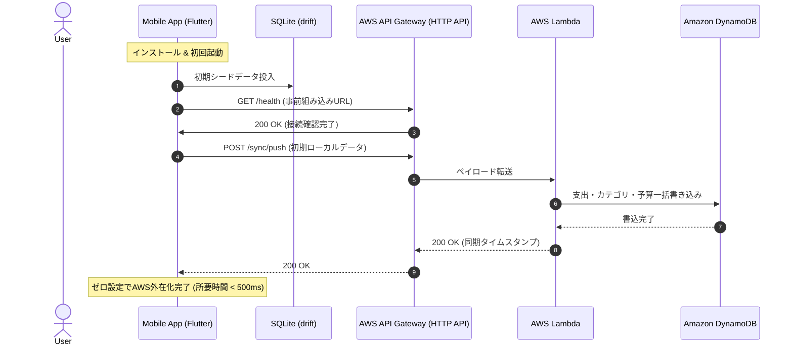
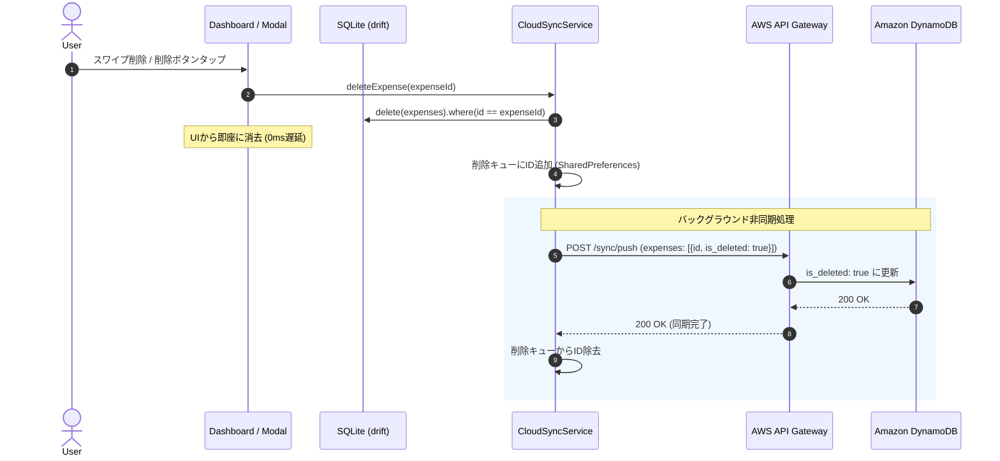

# クラウド同期 設計（既存資料の統合）

- **バージョン**: v0.1.0
- **ステータス**: draft
- **資料区分**: 過去資料（現行仕様・工程ゲートの対象外）
- **整理日**: 2026-11-01（JST）

対応要求: [要求案](../../../req/features/aws-cloud-database-sync.md)。要求がdraftのため、本書は未確定の既存設計資料として保管する。

## 保存時点の移行範囲と確定条件

既存の仕様・詳細設計を同一文書へ移した。以下の保存節は当時の案であり、実装との一致・検証完了を保証しない。重複や矛盾は採用判断をせず保持し、[差分一覧](../../../STATUS.md)へ記録した。REQ確定後に振る舞い・データモデル・状態管理・異常系を同期し、レビューする。

追加項目は親機能へ集約: `aws-cloud-sync-builtin-endpoint`、`expense-deletion-sync-fix`。同じ対象データ・操作の拡張であり、独立した機能として重複登録しない。

## 保存資料: aws-cloud-database-sync / 仕様

移行元: `docs/spec/features/aws-cloud-database-sync.md`。旧節番号とコード例を保持。

### AWSクラウドデータベース外在化・同期機能 (aws-cloud-database-sync) 仕様書

#### 1. 目的・概要
これまで端末内ローカルデータベース（SQLite）のみに保存されていた支出明細、カテゴリマスター、予算設定データを、AWSクラウド上のデータベースへ外在化・永続化する。
これにより、端末紛失・機種変更時のデータ復元、複数端末間でのデータ共有を実現する。

##### 制約・コスト目標
- **月額運用コスト**: **月々500円（約 $3.2 USD）以内**を絶対条件とする。
- **インフラ構成**: **Terraform (IaC)** により、インフラ環境の構築・更新・破棄を完全自動化・コード管理可能にする。
- **UXの維持**: ネットワークが圏外・不安定な場合でも支出の即時記録を妨げない「オフラインファースト＋クラウド同期」方式を採用する。

---

#### 2. コスト試算とアーキテクチャ選定

##### 2.1 データベース・インフラ選定理由

| 構成案 | 想定月額コスト | 判定 | 理由 |
| :--- | :---: | :---: | :--- |
| **AWS RDS (PostgreSQL/MySQL)** | 約 2,200〜3,000円/月<br>($14〜$20) | ✕ 不採用 | 最低スペック（`db.t4g.micro`）でも月500円を大幅に超過するため。 |
| **Aurora Serverless v2** | 約 6,000円〜/月<br>($40〜) | ✕ 不採用 | 最低0.5 ACUの常時稼働で予算超過。 |
| **ECS Fargate / App Runner** | 約 1,000〜2,000円/月 | ✕ 不採用 | コンテナ常時稼働コストが予算超過。 |
| **完全サーバーレス<br>(API Gateway HTTP API + Lambda + DynamoDB)** | **約 0〜20円/月<br>($0.00〜$0.15)** | **◎ 採用** | **常時無料枠（Free Tier）を最大限活用可能。月500円枠に対して95%以上の余裕を達成。** |

##### 2.2 月額コスト詳細試算表 (月間1万リクエスト想定)

| AWS サービス | 課金体系・無料枠 | 想定利用量 | 想定月額コスト (USD) | 想定月額コスト (円) |
| :--- | :--- | :--- | :---: | :---: |
| **Amazon DynamoDB** | 25GB ストレージ無料<br>25 WCU / 25 RCU 無料 | ストレージ < 50MB<br>オンデマンド従量課金 | **$0.00** | **0 円** |
| **AWS Lambda** | 毎月 100万回無料<br>320万秒コンピューティング無料 | 月間 1〜2万回実行<br>(平均 100ms) | **$0.00** | **0 円** |
| **Amazon API Gateway (HTTP API)** | 100万回あたり $1.00 | 月間 1〜2万回 | **$0.01〜$0.02** | **約 2〜3 円** |
| **Amazon CloudWatch Logs** | 5GB ログ収集無料 | 小規模アクセスログ (< 50MB) | **$0.00** | **0 円** |
| **合計** | - | - | **約 $0.02 / 月** | **約 3 円 / 月** |

---

#### 3. ユーザーフロー・画面要件

##### 3.1 ユーザーフロー
1. **クラウド同期の自動実行**:
   - アプリ起動時、支出登録・編集・削除完了時、または外部決済連携（Apple Pay）受信時に、バックグラウンドで自動的にAWS上のDynamoDBへ差分同期される。
2. **手動同期とステータス確認**:
   - 設定画面（またはダッシュボード）にて、現在のクラウド同期ステータス（「同期完了」「未同期 3件」「同期中...」）および「最終同期日時」を確認できる。
   - 「今すぐ同期」ボタンをタップして即時同期をトリガーできる。
3. **オフライン時の挙動**:
   - 圏外・通信エラー時でもローカルDBへ即座に保存され、アプリ操作は一切ブロックされない。未同期フラグが立ち、次回ネットワーク開通時に自動で再送される。

##### 3.2 画面要件 (UI Specifications)
- **画面仕様書 (draw.io)**: [docs/spec/screens.drawio](../../../spec/screens.drawio) （タブ: `クラウド同期設定画面` / SCR-008）
- **同期ステータスインジケーター**:
  - クラウドアイコン＋ステータスバッジ（緑: クラウド保存済、黄: 未同期データあり、青: 同期中、赤: 同期エラー）
- **設定項目**:
  - クラウド自動同期トグル（デフォルト: ON）
  - デバイス識別子 (UUID) の表示とリセット
  - 「今すぐクラウドと同期」ボタン

---

#### 4. データモデル・同期ルール

##### 4.1 DynamoDB テーブル設計 (Single/Multi-table)
リージョン: `ap-northeast-1` (東京)
課金モード: `PAY_PER_REQUEST` (オンデマンド)

###### ① 支出テーブル (`iris_expenses`)
- **PK**: `user_id` (String) - ユーザー/デバイスUUID
- **SK**: `expense_id` (String) - 支出UUID
- **GSI1-PK**: `user_id`, **GSI1-SK**: `spent_at` (ISO8601 文字列) - 日付範囲クエリ用
- **属性**: `amount`, `category_id`, `merchant_name`, `spent_at`, `payment_method`, `external_tx_id`, `updated_at`, `is_deleted` (論理削除フラグ)

###### ② カテゴリテーブル (`iris_categories`)
- **PK**: `user_id` (String)
- **SK**: `category_id` (String)
- **属性**: `name`, `icon_name`, `color_hex`, `sort_order`, `updated_at`, `is_deleted`

###### ③ 予算テーブル (`iris_budgets`)
- **PK**: `user_id` (String)
- **SK**: `budget_id` (固定: `current`)
- **属性**: `monthly_amount`, `start_day`, `is_category_budget_enabled`, `is_alert_notification_enabled`, `updated_at`

##### 4.2 双方向差分同期ロジック (Last-Write-Wins)
1. **Pull (AWS $\rightarrow$ ローカル)**:
   - クライアントはローカルの `last_synced_at` タイムスタンプを送信。
   - サーバーは `updated_at > last_synced_at` のレコードのみを抽出して返却。
   - クライアントはローカルDBに反映（`is_deleted == true` の場合はローカルでも論理/物理削除）。
2. **Push (ローカル $\rightarrow$ AWS)**:
   - クライアントはローカルで未同期（`is_synced == false`）の追加・更新・削除レコードを一括送信。
   - サーバーは DynamoDB の `PutItem` / `UpdateItem` を実行。
   - 成功後、クライアント側で該当レコードの `is_synced = true` に更新。

---

#### 5. エラーハンドリング・エッジケース

1. **オフライン・ネットワーク切断**:
   - リクエスト失敗時はローカルの未同期キューに保持し、指数バックオフで再試行。
   - ユーザー操作（支出記録など）には一切エラーダイアログ等を出さず、操作性を最優先する。
2. **コンフリクト（競合）解決**:
   - 同一レコードが複数端末で更新された場合は、`updated_at` が新しい方を優先（Last-Write-Wins）。
3. **コスト防壁 (AWS CloudWatch / Budget Alert)**:
   - AWS Budgets により、月間利用料金が **300円 ($2.00)** を超えた段階でアラートメールを送信する安全装置をTerraformで自動プロビジョニングする。

## 保存資料: aws-cloud-database-sync / 詳細設計

移行元: `docs/implementation/features/aws-cloud-database-sync.md`。旧節番号とコード例を保持。

### AWSクラウドデータベース外在化・同期機能 (aws-cloud-database-sync) 詳細設計書

#### 1. システムアーキテクチャ構成

完全サーバーレスアーキテクチャを採用し、月額500円以内の極低コスト運用と、ゼロメンテナンス・高信頼性を両立します。



---

#### 2. Terraform (IaC) ディレクトリ構成

インフラはすべて `terraform/` ディレクトリ配下にコード化し、`terraform apply` 一発で構築・更新可能とします。

```text
terraform/
├── versions.tf          # Terraform バージョン / AWS プロバイダー設定
├── variables.tf         # 入力変数 (環境名, リージョン, アラート用メール等)
├── outputs.tf           # 出力値 (API Gateway URL等)
├── dynamodb.tf          # DynamoDB テーブル定義 (expenses, categories, budgets)
├── iam.tf               # Lambda 実行用 IAM ロール・最小権限ポリシー
├── lambda.tf            # Lambda 関数定義 (zip化 & アップロード)
├── apigateway.tf        # HTTP API v2, ルート, CORS, 統合定義
├── budgets.tf           # AWS Budgets コスト超過アラート ($2.00)
└── lambda/
    ├── index.js         # 同期処理ハンドラ (Node.js)
    └── package.json     # 依存関係定義 (AWS SDK v3)
```

---

#### 3. Terraform リソース定義詳細

##### 3.1 DynamoDB テーブル (`dynamodb.tf`)
- **`iris_expenses`**:
  - `hash_key`: `user_id` (S)
  - `range_key`: `expense_id` (S)
  - `billing_mode`: `PAY_PER_REQUEST`
  - GSI: `user_spent_at_index` (PK: `user_id`, SK: `spent_at`)
- **`iris_categories`**:
  - `hash_key`: `user_id` (S)
  - `range_key`: `category_id` (S)
  - `billing_mode`: `PAY_PER_REQUEST`
- **`iris_budgets`**:
  - `hash_key`: `user_id` (S)
  - `range_key`: `budget_id` (S)
  - `billing_mode`: `PAY_PER_REQUEST`

##### 3.2 API Gateway HTTP API (`apigateway.tf`)
- プロトコル: `HTTP` (REST APIと比較して70%安価、高速)
- CORS設定: 全許可（モバイルアプリからのアクセス用）
- ルート:
  - `POST /sync/push`: ローカル変更データの一括登録・更新
  - `GET /sync/pull`: 最終同期以降の差分データ取得
  - `GET /health`: 接続確認用エンドポイント

##### 3.3 コスト防壁 AWS Budgets (`budgets.tf`)
- 予算額: **$2.00 / 月**（約310円）
- アラート閾値:
  - 予測支出が 80% ($1.60) に達した時
  - 実支出が 100% ($2.00) に達した時
- 通知先: 指定の管理者メールアドレス

---

#### 4. API インターフェース設計

##### 4.1 `POST /sync/push`
- **リクエストヘッダー**: `x-user-id: <Device UUID>`
- **リクエストボディ**:
```json
{
  "last_synced_at": "2026-10-04T12:00:00.000Z",
  "expenses": [
    {
      "expense_id": "uuid-1234",
      "amount": 1500,
      "category_id": "cat-food",
      "merchant_name": "セブンイレブン",
      "spent_at": "2026-10-04T08:30:00.000Z",
      "payment_method": "apple_pay",
      "external_tx_id": "tx-9999",
      "updated_at": "2026-10-04T08:30:05.000Z",
      "is_deleted": false
    }
  ],
  "categories": [],
  "budget": {
    "monthly_amount": 180000,
    "start_day": 1,
    "is_category_budget_enabled": false,
    "is_alert_notification_enabled": true,
    "updated_at": "2026-10-04T08:00:00.000Z"
  }
}
```
- **レスポンス**: `200 OK`
```json
{
  "success": true,
  "synced_at": "2026-10-04T12:35:00.000Z",
  "processed_counts": {
    "expenses": 1,
    "categories": 0,
    "budget": 1
  }
}
```

##### 4.2 `GET /sync/pull?since=<ISO8601>`
- **リクエストヘッダー**: `x-user-id: <Device UUID>`
- **レスポンス**: `200 OK`
```json
{
  "server_time": "2026-10-04T12:35:00.000Z",
  "expenses": [...],
  "categories": [...],
  "budget": {...}
}
```

---

#### 5. クライアント側（Flutter）実装設計

##### 5.1 クライアントディレクトリ構成
```text
lib/features/sync/
├── data/
│   └── datasources/
│       └── cloud_sync_api_client.dart   # HTTP通信クライアント
├── domain/
│   ├── models/
│   │   ├── sync_payload.dart            # 同期リクエスト/レスポンスモデル
│   │   └── sync_status.dart             # 同期進捗ステータスenum
│   └── services/
│       └── cloud_sync_service.dart      # 双方向差分同期ロジック
└── presentation/
    ├── providers/
    │   └── cloud_sync_provider.dart     # 同期状態・最終同期日時管理
    └── widgets/
        └── sync_status_badge.dart       # クラウド同期ステータスバッジ
```

##### 5.2 差分同期（Sync）実行フロー
1. `SharedPreferences` から `x-user-id`（デバイス固有UUID）と `last_synced_at` を取得。
2. **Push**:
   - ローカルDBから `is_synced == false` のレコードを抽出。
   - `POST /sync/push` でAWSへ送信。
   - 成功したらローカルの `is_synced = true` に更新。
3. **Pull**:
   - `GET /sync/pull?since=<last_synced_at>` を実行。
   - サーバーから受信したレコードをローカルSQLiteへ upsert（更新または挿入）。
4. `last_synced_at` をサーバー時刻で更新。

---

#### 6. テスト・運用計画

1. **Terraform 単体検証**:
   - `terraform fmt -check`, `terraform validate`
   - `tflint` によるセキュリティ・ベストプラクティス検査
2. **API・Lambda 統合テスト**:
   - `/health` エンドポイント接続確認
   - 差分プッシュ・プルによるデータの整合性確認
3. **Flutter 側モックテスト**:
   - `test/unit/cloud_sync_service_test.dart`（オフラインフォールバック、差分反映の検証）

## 保存資料: aws-cloud-sync-builtin-endpoint / 仕様

移行元: `docs/spec/features/aws-cloud-sync-builtin-endpoint.md`。旧節番号とコード例を保持。

### AWSクラウドエンドポイント事前接続・自動同期機能 (aws-cloud-sync-builtin-endpoint) 仕様書

#### 1. 目的・概要
ユーザーがアプリをインストールした直後から、エンドポイントの手動入力や設定操作を一切必要とせず、実装・ビルド時点でプロビジョニングされた本番AWS API Gatewayと即座に自動接続されている状態を実現する。

##### 解決する課題
- **手動設定の排除**: これまでは「設定画面を開いてTerraformの出力URLを入力する」必要があったが、これを完全に自動化し、アプリを開いた瞬間からAWS DynamoDBへの外在化・同期がバックグラウンドで開始される。
- **即時クラウド永続化**: 端末の初期データ、過去の支出、初回登録した明細が、インストール直後から即座にAWSクラウド上へ安全に保管される。
- **再インストール時のユーザーID固定化**: 単一ユーザー運用として、ユーザーID（`user_id`）をアプリ内定数（`028692f2-c4c5-4299-9eb0-0ae7ed02049c`）として永続固定化。アプリのアンインストールや再インストールを行ってもユーザーIDがブレず、常に同一のクラウドDBと接続される。

---

#### 2. ユーザーフロー・画面要件

##### 2.1 ユーザーフロー
1. **アプリ起動**:
   - 初回インストール後、アプリを起動した時点で自動的にAWS上のDynamoDBとの接続確立と初回同期（Pull & Push）がバックグラウンドで実行される。
2. **支出登録時の自動同期**:
   - 手動での支出登録、編集、削除、または Apple Pay 外部連携による自動記録が行われた直後に、非同期で最新データがAWSへPushされる。
3. **設定画面での確認**:
   - 設定画面（`CloudSyncScreen` / SCR-008）を開くと、最初から「接続先: AWS本番環境（https://...execute-api...）」が設定されており、「クラウド連携: 接続済み（緑バッジ）」として表示される。
   - （上級者向け）必要に応じてカスタムエンドポイント（ステージング環境等）へ上書き変更できる機能は維持する。

##### 2.2 画面コンポーネント要件
- **画面仕様書 (draw.io)**: [docs/spec/screens.drawio](../../../spec/screens.drawio) （タブ: `クラウド同期設定画面` / SCR-008）
- **初期接続ステータス**:
  - デフォルト状態で「☁️ AWS DynamoDB と同期完了」または「待機中」となり、URL未設定エラーは発生しない。
- **エンドポイント表示**:
  - ビルトインされた本番エンドポイントURLが初期値としてフォーム内に表示される。

---

#### 3. 接続・自動同期ライフサイクル仕様

| タイミング | トリガー | 同期アクション | 失敗時の挙動 |
| :--- | :--- | :--- | :--- |
| **アプリ起動時** | `MainNavigationShell.initState` | `syncNow()` (Pull & Push) | エラーダイアログは出さず、ローカルモードで継続 |
| **支出手動登録・編集時** | `ExpenseFormModal.onSaved` | 非同期で `syncNow()` (Push) | ローカル保存完了を最優先し、バックグラウンドで再試行 |
| **Apple Pay連携時** | `DeepLinkService.onIngestion` | 非同期で `syncNow()` (Push) | ローカル保存完了後にサイレント再試行 |
| **手動同期タップ時** | 「今すぐ同期する」ボタン | `syncNow()` | スピナー表示 ＆ 完了/失敗トースト通知 |

---

#### 4. エラーハンドリング・エッジケース

1. **オフライン起動時**:
   - 初回起動時にネットワークがオフラインの場合でも、アプリ起動や画面描画を一切遅延・ブロックさせない。
   - 通信可能になった段階、または次回のユーザー操作時に自動で再接続・同期を実行する。
2. **コスト保護**:
   - 頻繁な支出入力によるリクエスト増加を防ぐため、自動同期リクエストは最小限の差分のみ送信し、AWS Budgets（月額 $2.00 ≒ 約310円 超過アラート）により月500円以内の運用を厳格に維持する。

## 保存資料: aws-cloud-sync-builtin-endpoint / 詳細設計

移行元: `docs/implementation/features/aws-cloud-sync-builtin-endpoint.md`。旧節番号とコード例を保持。

### AWSクラウドエンドポイント事前接続・自動同期機能 (aws-cloud-sync-builtin-endpoint) 詳細設計書

#### 1. アーキテクチャ・設計概要

ユーザーが手動で接続先URLを入力することなく、ビルド・インストール時点でプロビジョニング済みの本番AWS API Gatewayと直結するアーキテクチャを定義する。



---

#### 2. モジュール・コンポーネント設計

##### 2.1 構成定数モジュール (`AppConfig`)
`lib/core/config/app_config.dart` を新設し、Terraformによって構築された本番エンドポイントURLを一元管理する。

```dart
class AppConfig {
  /// AWS API Gateway (HTTP API) の事前デプロイ済み本番エンドポイント
  static const String defaultCloudSyncEndpoint =
      'https://tidcbcu3f9.execute-api.ap-northeast-1.amazonaws.com';

  /// 単一ユーザー運用時の固定ユーザーID（AWS DynamoDB パーティションキー）
  static const String defaultUserId = '028692f2-c4c5-4299-9eb0-0ae7ed02049c';
}
```

##### 2.2 `CloudSyncApiClient` & `CloudSyncService` のデフォルト連携
- `CloudSyncApiClient`:
  - `baseUrl` のデフォルト値を `AppConfig.defaultCloudSyncEndpoint` に変更。
- `CloudSyncService`:
  - `getApiEndpoint()` で `SharedPreferences` にカスタム設定がない場合、常に `AppConfig.defaultCloudSyncEndpoint` を返却。
  - `getOrCreateUserId()` で、常に `AppConfig.defaultUserId` を返却（再インストール時も同一IDを保証）。

##### 2.3 自動同期ライフサイクルトリガーの統合
1. **アプリ起動時 (`MainNavigationShell`)**:
   ```dart
   @override
   void initState() {
     super.initState();
     WidgetsBinding.instance.addPostFrameCallback((_) {
       // ディープリンク監視の開始
       ref.read(deepLinkServiceProvider).initialize(...);
       // バックグラウンドでのAWS自動初期同期
       ref.read(cloudSyncStateProvider.notifier).syncNow();
     });
   }
   ```
2. **手動支出保存時 (`ExpenseFormModal`)**:
   - DB更新・スナックバー表示後、非同期で `ref.read(cloudSyncStateProvider.notifier).syncNow()` をトリガー。
3. **外部決済連携時 (`MainNavigationShell._handleIngestionResult`)**:
   - 決済イベント取り込み成功時に非同期で `ref.read(cloudSyncStateProvider.notifier).syncNow()` をトリガー。

---

#### 3. インフラプロビジョニング・反映手順

1. **インフラのデプロイ (`terraform apply`)**:
   - `terraform/` 配下で `terraform apply` を実行し、AWS上にリソースを作成。
   - 出力される `api_endpoint`（例: `https://abcd1234ef.execute-api.ap-northeast-1.amazonaws.com`）を取得。
2. **エンドポイント定数の更新**:
   - `lib/core/config/app_config.dart` の `defaultCloudSyncEndpoint` に実URLを反映。
3. **ビルド & インストール**:
   - `flutter build ios` / `flutter install` を実行することで、インストール直後から本番AWSと直結されたアプリが完成する。

---

#### 4. テスト方針

1. **デフォルト接続先テスト (`test/unit/cloud_sync_service_test.dart`)**:
   - カスタムエンドポイントが未設定の時、`AppConfig.defaultCloudSyncEndpoint` がデフォルトの接続先として使用されることを検証。
2. **自動同期ライフサイクルの検証**:
   - `MainNavigationShell` 起動時に `syncNow()` が呼び出されること。

## 保存資料: expense-deletion-sync-fix / 仕様

移行元: `docs/spec/features/expense-deletion-sync-fix.md`。旧節番号とコード例を保持。

### 支出削除の即時反映・同期不具合修正 (expense-deletion-sync-fix) 仕様書

#### 1. 目的・概要
ユーザーが支出を削除（ダッシュボードのスワイプ削除、または編集モーダルからの削除）した際に、ローカルDBのみが削除されてクラウド（AWS DynamoDB）へ削除情報が通知されず、その後の同期（Pull）によってクラウドから古い支出データが再ダウンロードされて復活してしまう不具合を解消する。
本仕様では、支出削除の即時UI反映と、クラウドへの確実な削除同期（Tombstone同期およびオフライン削除キュー）を規定する。

---

#### 2. ユーザーフロー・画面要件

##### 2.1 ユーザーフロー
1. **ダッシュボードからのスワイプ削除**:
   - ユーザーが明細を左スワイプして削除を実行。
   - UI上から対象の支出が即座に消去され、日次合計金額・残り予算が即座に再計算される。
   - バックグラウンドでAWSクラウドへ削除差分がPushされ、クラウド上でも削除状態（`is_deleted: true`）へ遷移する。
2. **支出編集モーダルからの削除**:
   - 編集モーダルで「削除」ボタンを押し、確認ダイアログで「削除」を選択。
   - モーダルが閉じ、即座に一覧から消去される。
   - バックグラウンドでAWSクラウドへ削除差分がPushされる。
3. **その後の同期（起動時・Pull-to-refresh等）**:
   - クラウド同期（Pull）が実行されても、削除済みの支出が再ダウンロードされて復活しない。

##### 2.2 画面要件
- **画面仕様書 (draw.io)**: [docs/spec/screens.drawio](../../../spec/screens.drawio) （タブ: `日次支出ダッシュボード` / SCR-001, `支出登録・編集モーダル` / SCR-005）
- スナックバー通知:
  - 削除時に「支出を削除しました」を表示（スワイプ削除時の「元に戻す」アクションも整合性を担保）。

---

#### 3. 機能要件・ビジネスロジック

##### 3.1 共通削除インターフェース (`deleteExpense`)
- すべての支出削除操作（スワイプ、モーダル削除）は単一の共通メソッドを経由する。
- 処理フロー:
  1. ローカルSQLiteから対象レコードを即時削除。
  2. 削除保留キュー（`iris_pending_deleted_expense_ids`）に対象の `expense_id` を登録。
  3. 即座にAWSへ削除差分（`is_deleted: true`）をPush（非同期）。
  4. Push成功時、削除保留キューから当該IDを除去。

##### 3.2 同期エンジン（`syncNow`）の削除保証
1. **Push同期時**:
   - ローカルDBの既存支出データに加え、削除保留キューに存在する全IDを `is_deleted: true` のレコードとしてPushペイロードに含める。
   - Pushが成功した場合、送信に成功した保留削除IDをキューから全件クリアする。
2. **Pull同期時**:
   - サーバーから返却された支出のうち、`is_deleted: true` のレコードはローカルDBから削除する。
   - 端末の削除保留キューに存在するIDのレコードが、サーバーから `is_deleted: false` で返ってきた場合でも、ローカルへの再挿入（復活）をブロックする。

---

#### 4. エラーハンドリング・エッジケース
1. **オフライン時の削除**:
   - 端末が圏外や機内モードの状態で削除した場合、ローカルでは即座に削除され、IDは保留キューに残り続ける。
   - 次回ネットワーク接続時（アプリ起動時やPull-to-refresh時）に自動的にクラウドへ削除通知が送られ、完全同期される。
2. **スナックバーの「元に戻す (Undo)」操作**:
   - ユーザーが「元に戻す」を押した場合、保留キューからIDを取り消し、ローカルDBに再挿入した上で、クラウドへ通常支出として再Pushする。

## 保存資料: expense-deletion-sync-fix / 詳細設計

移行元: `docs/implementation/features/expense-deletion-sync-fix.md`。旧節番号とコード例を保持。

### 詳細設計書: 支出削除の即時反映・同期不具合修正 (expense-deletion-sync-fix)

#### 1. 現状の不具合分析と設計方針

##### 1.1 不具合の根本原因
1. **ローカル物理削除とクラウド同期の不整合**:
   - アプリ側で `db.delete(db.expenses)` による物理削除を行った後、ローカルDBからは対象レコードが完全に消滅する。
   - そのため、同期処理（`syncNow()`）がローカルDBから取得する `localExpenses` には削除されたレコードが含まれず、AWSへのPushペイロードにも `is_deleted: true` が含まれない。
2. **クラウドからのゾンビ復活**:
   - AWS DynamoDB 上には依然として `is_deleted: false` のレコードが存在し続ける。
   - Push直後の差分Pull処理において、AWSから当該レコードが取得され、ローカルSQLiteへ `insertOnConflictUpdate` で再登録されることで、削除した支出が復活する。

##### 1.2 設計方針
- **Tombstone（墓石）キュー方式**:
  - ローカルから物理削除すると同時に、削除されたIDを「未同期削除キュー（`pending_deleted_expense_ids`）」に記録。
  - 即座にAWSへ単件削除Push（`is_deleted: true`）を非同期送信。
  - 全体同期（`syncNow`）時にも削除キューの全IDを `is_deleted: true` としてPush。
  - Pull時に削除キュー内のIDが未削除データとして届いても、ローカルへの再登録を拒否する防壁を配置。

---

#### 2. モジュール・インターフェース設計

##### 2.1 `CloudSyncService` の拡張
```dart
class CloudSyncService {
  static const String _prefKeyPendingDeletedExpenseIds = 'iris_pending_deleted_expense_ids';

  /// 削除保留中IDリストの取得・更新
  Future<List<String>> getPendingDeletedExpenseIds();
  Future<void> addPendingDeletedExpenseId(String id);
  Future<void> removePendingDeletedExpenseIds(List<String> ids);

  /// 支出の完全削除処理（ローカル削除 + クラウドPush + キュー管理）
  Future<void> deleteExpense(String expenseId);

  /// 削除の取り消し（元に戻す）
  Future<void> restoreExpense(Expense expense);
}
```

##### 2.2 `CloudSyncService.deleteExpense` のシーケンス


##### 2.3 `syncNow` の同期ロジック改修
1. **Pushデータ構築**:
   ```dart
   final localExpenses = await _db.select(_db.expenses).get();
   final pendingDeletedIds = await getPendingDeletedExpenseIds();

   final expensesPayload = [
     // 有効なローカル支出
     ...localExpenses.map((e) => {
       'expense_id': e.id,
       ...
       'is_deleted': false,
     }),
     // 削除保留中の支出
     ...pendingDeletedIds.map((id) => {
       'expense_id': id,
       'updated_at': DateTime.now().toIso8601String(),
       'is_deleted': true,
     }),
   ];
   ```
2. **Push成功時**:
   - `removePendingDeletedExpenseIds(pendingDeletedIds)` を呼び出し、送信完了したIDをキューから消去。
3. **Pullマージ時**:
   ```dart
   for (final expMap in pullResult.expenses) {
     final expId = expMap['expense_id'] as String?;
     final isDeleted = expMap['is_deleted'] as bool? ?? false;

     // サーバー側で削除済み、または端末で削除保留中の場合はローカルDBから削除
     if (isDeleted || pendingDeletedIds.contains(expId)) {
       await (_db.delete(_db.expenses)..where((tbl) => tbl.id.equals(expId))).go();
     } else {
       await _db.into(_db.expenses).insertOnConflictUpdate(...);
     }
   }
   ```

---

#### 3. 画面コンポーネント改修

##### 3.1 `DailyExpenseDashboardScreen`（スワイプ削除）
- `Dismissible.onDismissed` 内で直接 `db.delete` を呼ぶのではなく、`ref.read(cloudSyncServiceProvider).deleteExpense(exp.id)` を呼び出す。
- スナックバーの「元に戻す」タップ時は `ref.read(cloudSyncServiceProvider).restoreExpense(exp)` を呼び出す。

##### 3.2 `ExpenseFormModal`（削除ボタン）
- 削除確認後、`ref.read(cloudSyncServiceProvider).deleteExpense(widget.editingItem!.expense.id)` を呼び出す。

---

#### 4. テスト計画
1. **単体テスト (`cloud_sync_service_test.dart`)**:
   - `deleteExpense` 呼び出しにより、ローカルDBから削除され、保留キューに対象IDが追加されること。
   - `syncNow` 時に保留削除IDが `is_deleted: true` としてPushペイロードに含まれること。
   - サーバーから未削除データがPullされても、保留削除IDに含まれる場合はローカルへ再挿入されないこと。
   - `restoreExpense` により、ローカルに再挿入され保留キューから除外されること。
