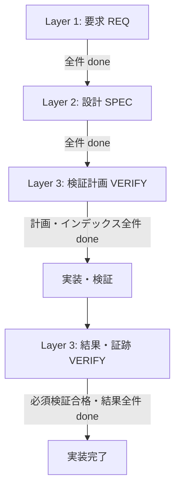

# OPERATIONS.md - 開発・運用ルール

- **バージョン**: v2.1.0
- **ステータス**: done

## 1. 階層と進行

Layer 0（運用） > Layer 1（要求: REQ） > Layer 2（設計: SPEC） > Layer 3（検証: VERIFY）。下位は上位に従う。実装・テストコードはドキュメント階層に含めない。

## 2. 運用文書一覧

| レイヤー / 工程 | 運用ルール | 成果物 |
| :--- | :--- | :--- |
| Layer 0 | [AGENTS.md](../../AGENTS.md)、本書 | 運用ルール、`.agents/skills/` |
| Layer 1 | [01_REQ.md](01_REQ.md) | [REQ](../req/REQ.md)、機能別要件 |
| Layer 2 | [02_SPEC.md](02_SPEC.md) | [SPEC](../spec/SPEC.md)、機能別設計、画面仕様 |
| Layer 3 | [03_VERIFY.md](03_VERIFY.md) | [VERIFY](../verification/VERIFY.md)、検証計画・ケース・結果・証跡 |
| 実装 | [IMPL.md](IMPL.md) | ソースコード、自動テスト、静的解析 |

詳細設計はLayer 2のSPECへ統合する。ownerの2026-11-01の指示により、レガシー資料・互換案内は削除し、以前の版はGit履歴で参照する。現行文書はREQ・SPEC・VERIFYを正本とする。

## 3. 上位同期と移行ゲート

各レイヤーの全ドキュメント・インデックスが `done` になってから次工程へ進む。`draft`・`wip`・`review` はゲートを通過しない。実装開始にはREQ・SPEC・VERIFY計画の確定を要求し、まだ存在しない検証結果は要求しない。計画確定は検証済みを意味しない。

実装はLayer 2の設計に従う。矛盾や技術的制約があれば、上位文書を先に修正・確定し、影響する計画・実装へ同期する。結果記録時のインデックス更新と不具合修正・再検証の扱いは [03_VERIFY.md](03_VERIFY.md) に従う。

## 4. ステータス・バージョン・コミット

すべての文書にバージョンとステータスを記載する。`draft` は作成中、`wip` はowner承認済み中間保存、`review` はレビュー中、`done` はレビュー完了を表す。内容変更時は文書とインデックスを即座に `draft` に戻す。

`/ai-docs` は文書作成・更新後、内蔵のレビュー工程を実行して完了判定まで行う。編集段階ではコミットせず、レビューのPASS時にコミットする。`/ai-docs` のレビュー工程は上位・同位との整合性と必須項目を確認し、PASS時に `done` へ更新・コミットする。未完了のWIPはownerに確認し承認時のみ `wip` でコミットする。FAILはステータスを確定せず、コミットせず指摘を報告する。developマージで正式確定とする。

## 5. スキルと変更管理

[ai-docsスキル](../../.agents/skills/ai-docs/SKILL.md) は現在のゲートに応じて要求、設計、検証計画、実装・結果記録を進め、各文書の更新後は内蔵のレビュー工程による判定まで行う。内蔵のレビュー工程は運用文書も含めた上位・同位整合性と完了判定を扱う。

着手前に目的・範囲・完了条件を確認する。コミットは関心事ごとに分け、`docs`・`feat`・`fix`・`test`・`refactor`・`chore` 等の明確なメッセージを用いる。

## 6. 横断する意思決定記録（ADR）

[ADR運用](ADR.md)に従い、[ADR一覧](../adr/ADR.md)と個別文書 `docs/adr/NNNN-<topic>.md` を管理する。要求・設計・検証を横断して判断理由と影響を残し、各レイヤーの正本と相互参照する。ADRは独立レイヤーではなく、後続工程のゲートを迂回しない。

## 7. 機能単位の集約と重複防止

REQ・SPEC・VERIFYは各レイヤーを分けたまま、関連する内容を同じ機能単位に集約する。追加依頼ごとのファイル・一覧行の新設を既定動作にしない。

1. 追加・更新前に3レイヤーのインデックスと関連機能文書を検索する。名称の一致だけでなく、解決する課題、責務、対象データ、ユースケース、業務ルール、受け入れ基準を比較する。
2. 既存機能の拡張・派生・例外・追加検証に当たる場合、既存文書の該当節や項目を更新・追加し、一覧の既存行を更新する。重複する受け入れ基準・設計・検証ケースは正本へ集約し、他の箇所から参照する。
3. 新規機能は、既存の責務・スコープに収まらず独立して説明できる場合に作成する。最も近い既存機能との違い、責務の境界、分割理由を本文に記録する。単なる名称違い・画面違い・追加時期の違いで分割しない。一方、関連が薄い責務まで一文書へ詰め込まない。
4. REQで定めた機能名・スコープをSPEC・VERIFYでも継承し、対応文書・項目IDを明示する。既存の識別子は保ち、共通事項は共通方針の正本を参照する。技術的な分割が必要でも独立した業務機能として一覧へ重複登録せず、親機能と分割理由を示す。
5. 既存の重複を集約する場合、受け入れ基準、設計条件、検証ケース・結果・証跡を欠落させず移す。旧項目IDと統合先の対応を記録し、インデックス、相互リンク、ADR参照を更新する。過去の検証結果は対象コミット・環境とともに履歴を保持し、現在の設計に合格した証拠として流用しない。
6. 内容変更した文書とインデックスはdraftに戻し、REQ→SPEC→VERIFYの確定ゲートを守る。上位が未確定の間に下位の内容変更を先行させない。影響先を特定しておき、上位確定後に同期する。

レビューでは、新規作成前の既存機能比較、集約先の妥当性、一覧の重複、分割理由、3レイヤー間の機能対応、参照・ID・検証履歴の維持を確認する。理由のない類似機能の追加や重複する正本があれば修正する。
