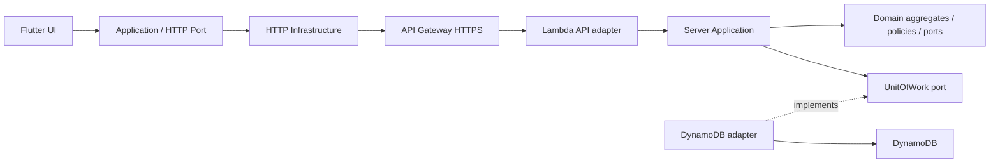

# 共通アーキテクチャ: AWS APIとドメイン契約

- **バージョン**: v2.0.1
- **ステータス**: done
- **更新日**: 2026-11-01（JST）

対応要求: [ARCH-01](../req/REQ.md#arch-01-ドメインモデルと契約による設計)、[ARCH-02](../req/REQ.md#arch-02-aws-api経由の読み書き)。DDD方針は[ADR-0002](../adr/0002-domain-contract-design.md)、配置・保存方式の変更は[ADR-0003](../adr/0003-cloud-api-only.md)。

## 1. 設計方法と正本

DDDで責務・集約・不変条件を定め、契約駆動設計でDTO・Port・事前/事後条件・失敗保証を固定する。業務条件は各機能書、HTTP形式は[OpenAPI](contracts/openapi.json)、共通型は[JSON Schema](contracts/shared.schema.json)、内部イベントは[イベントSchema](contracts/events.schema.json)を正本とする。

## 2. 境界づけられたコンテキストと機能対応

| コンテキスト | 配置と責務 |
| :--- | :--- |
| ExpenseLedger | Lambda側。Expense集約と日次/履歴のReadModel |
| CategoryCatalog | Lambda側。CategoryCatalog、名称一意・順序・廃止先対応 |
| Budgeting | Lambda側。BudgetPlan/Allocation、期間計算・閾値receipt |
| PaymentIntegration | Lambda側のACL。正規化・分類・LedgerIngestionPortへの委譲 |
| CloudAccess | アプリ側の技術的能力。HTTP要求・応答、結果不明・再試行、接続設定。旧Replicationを置換 |
| PresentationPolicy / BrandAssets | アプリ側の純粋Policy・UI状態とビルド時検査。業務集約なし |

端末に業務データのDB・永続キャッシュ・保留送信キューを置かない。表示・ドラフトはプロセスメモリのみ。結果不明の要求ID/入力もセッション内だけに保持し、再起動で自動再送しない。再起動後はAPI取得で確定データを確認する。接続先など非業務設定とOS通知は別扱い。DynamoDB SDK/資格情報をアプリへ配布せず、IAMでLambdaからのアクセスを許可する。

## 3. ユビキタス言語・値オブジェクト

| 型 | 意味・制約 |
| :--- | :--- |
| ExpenseId / CategoryId / OwnerId | 空でないID。新規業務IDはUUID。固定カテゴリIDを維持 |
| MoneyJPY / AllocationYen | 支出1〜99,999,999整数、配分0〜99,999,999整数。合計・残額は別型 |
| Memo | trim・改行空白化後100grapheme以内、空値はnull |
| CategoryName | trim後1〜20grapheme。NFKC/lowercaseのnameKeyで一意判定 |
| SearchText / MerchantKey | NFKC/lowercase/trim。表示値と区別 |
| Instant / LocalDate / TimeZone | 通信はUTCミリ秒。端末のIANA timeZoneを明示し、日界は[start,nextStart) |
| CalendarMonth / BudgetPeriod | 暦月と開始日1〜28の家計期間を区別 |
| AggregateVersion | サーバー集約の正の整数。CASに使用し、削除後も保持 |
| RequestId | コマンドのUUID。再送時に変更しない。Owner/操作/正規化入力と結合 |
| SnapshotId | ownerのreadGenerationとフィルタ指紋を結ぶ不透明トークン。集約版と別 |
| UndoGrant | サーバー保存の不透明トークン。削除版・元内容・使用状態を持つ |

## 4. レイヤー・依存方向・配置

アプリ: presentation → application → API Port。InfrastructureがHTTP Port・通知・設定Portを実装しProviderで注入する。端末側にRepositoryのDB実装は置かない。

サーバー: API adapter → Application Handler → Domain/owned ports。InfrastructureがDynamoDB Repository・UnitOfWork・イベント配送を実装する。DomainはFlutter/Riverpod/AWS SDK/HTTPへ依存しない。既存terraform/lambda/index.jsは移行元であり、目標はserver/{domain,application,infrastructure,api}相当の分離。言語・ファイル配置は実装時にこの依存方向を守って具体化する。

ReadModelもサーバーQueryPortから返す。SDK項目・Entityを公開DTOへ流用せずmapperを介する。

## 5. 契約の共通規則

現行の操作契約はv2.0.0、HTTPはschemaVersion=3。破壊的変更として旧wire版2を置換し、旧/sync/push・/sync/pullは現行APIに含めない。既存IDの削除は機能書の廃止表で追跡する。内部イベントschemaVersion=2へ改訂する（CategoryRetired payload変更）。

- Result<T>はSuccess(value,warnings,readGeneration,aggregateVersion?)またはFailure(error,field?,retryable)。HTTPの正式表現はSchemaを使う。
- 共通エラー: ValidationFailed/InvariantViolation/UnsupportedVersion=400、NotFound=404、OwnerMismatch=403、VersionConflict/Busy/CursorInvalidated=409、UndoExpired=410、PayloadTooLarge=413、StorageFailure=500、TransportFailure=503。HTTP以外の型も同じ意味。
- 保存成功はサーバーcommit確定応答後だけ。アプリはフォームを保持して保存中を表示し、二重操作を無効化。通信なしでは保存しない。タイムアウトは失敗確定ではなくUnknownOutcomeと表示し、同じrequestId/入力で再送する。
- DynamoDBのCommandReceipt(ownerId,requestId)に操作名・正規化入力のSHA-256・元の応答を保存する。業務状態・版・readGeneration・DomainEventOutbox・Receiptを同一TransactWriteItemsで確定する。Receiptは受信直後に確認する。requestIdの入力比較は省略フィールドを含む受信入力のcanonical JSONで行い、正規化した値と初回受信日時をReceiptへ保存する。日時省略を再送時の現在時刻で再評価しない。同じID/入力の再送は元の応答を返し、異なる入力は409。receiptは自動消去しない。要求IDを変えて結果不明の操作を再送しない。
- expectedVersionはサーバーでCAS。端末updatedAtによるLWWを採用しない。Queryは業務状態・集約版・イベントを書き換えない。
- Query/変更成功後は必要画面をAPIから再取得する。起動/復帰/明示更新でも取得。通信失敗で0件にせず、メモリ内の前回表示に未更新・再試行を表示する。再起動後に通信不可ならエラー画面。自動ポーリング/プッシュ通知による端末間リアルタイム更新は要求しない。

## 6. 集約間整合・イベント・Port

ExpenseRepository、CategoryCatalogRepository、BudgetRepositoryはサーバーDomain所有。UnitOfWorkはDynamoDB条件付き取引を実装する。状態を変えるCommandはownerのReadGenerationをCASで1進め、カテゴリ参照に使ったCatalog版も取引で確認する。初回世代/Plan作成は属性不存在を条件に行う。業務状態を変えない既適用操作はReceiptだけを世代ConditionCheckと共に保存し、集約版/世代/イベントを増やさない。競合は入力を保持して再取得へ誘導する。

カテゴリ廃止で任意件数のExpenseを一度に更新する取引は作らない。CatalogにretiredCategoryId→cat_uncategorizedの恒久対応を残し、同じ取引で有効Catalogから除外・BudgetPlanの配分削除・各版と世代・イベント・Receiptを更新する。Expenseロード/ReadModel/検索/集計は常に有効カテゴリを解決する。これで既存支出の未分類化を一体で可視化し、金額・ID・日時を保持する。廃止IDの再利用は禁止。任意の明細件数でも取引件数は増えない。

CatalogとBudgetPlanの各DynamoDB項目のエンコード後サイズ上限は150KiB。超過は413で変更前に拒否する。各コマンドの取引は最大20項目・合計1MiB以内に固定し、同一項目へ複数の取引操作を発行しない。容量条件はprovider契約テストで確認する。

DomainEventOutboxはサーバーの追記型イベント保存。イベントIDは集約ID/版/種類から生成し、commit後に配送する。配送はat-least-once、consumerはeventId/期間閾値receiptで重複排除。端末の同期Outboxは存在しない。イベント形式とHTTP DTOを混同しない。

## 7. DynamoDB・API・UIとの対応

データモデルは[SPEC](SPEC.md#dynamodb-model)を正本とする。SDKのStrongly consistent readを使い、Queryでowner世代を前後に強整合読取する。その間の全データページ取得とCatalog/Budget読取後、世代が一致した場合だけ応答する。GSIや結果整合読取をスナップショット保証の根拠にしない。世代が変化した場合は最大2回再取得し、なお変化ならBusy。

HistoryCursor/SnapshotIdはowner・条件指紋・readGeneration・最後の(spentAt,id)・timeZoneを含めHMAC署名しクライアントが改変できない不透明値とする。期限は発行後15分。別owner/条件/期限/世代不一致はCursorInvalidated。ページと合計を同じ世代で返し、世代変更時は先頭から再取得する。生のDynamoDB LastEvaluatedKeyを公開しない。

取得はownerパーティションの全ページを強整合Queryし、サーバーで期間・正規化検索・有効カテゴリ・sourceを絞り、安定順に並べる。ページサイズ50はAPI応答の件数であり集計対象を50件へ制限しない。月500円は目標で、データ量に比例する読取コスト・レイテンシーを測定する。Lambdaの実行期限またはAPI応答サイズ予算内で全件取得/応答ができなければBusyを返し、部分合計を成功にしない。

スワイプ削除はcommit後に非表示。削除応答受領後に5秒のUndo UIを表示する。Restoreは同Grantを使い、サーバー受信が削除commitから30秒未満で、削除版一致・未使用なら復元する。30秒は配送遅延余裕でUIの5秒を延長しない。Grantと元内容はサーバーに保持し、TTL削除時刻に依存せず期限を検査。復元時のカテゴリが廃止済みなら未分類へ解決し、古いカテゴリを再有効化しない。期限切れは410、応答喪失の再送はReceiptを先に確認する。

## 8. 契約の移行と検証

既存のSQLiteコード・Terraform/Lambdaは移行元であり適合済みではない。旧端末DBの移行・自動アップロード・消去を本設計に含めない。既存クラウド項目はデプロイ前にサーバー専用移行で版・メタデータ・Catalog/Planを作成し、件数/金額/ID/参照を比較する。移行中は書込停止し、完了検証後にAPI版3を有効化。失敗時はバックアップへ戻し旧APIを維持する。旧APIの書込を停止してから新アプリを切り替え、混在書込を許可しない。

認証方式の追加は今回対象外。固定OwnerIdは認証資格ではなく、APIキー/Authorizerは定義しない。単一所有者・非公開サービスの従来制約を継承し、公開運用に必要な認証の解決を本設計完了と混同しない。

[VERIFY](../verification/VERIFY.md)で依存方向、HTTP consumer/provider、DynamoDB原子性・CAS・再送・Query世代・通信なしを検証する。文書doneは実装済みを意味しない。

内部PolicyのSnapshotMismatchはHTTPでCursorInvalidated、UnsupportedSourceはValidationFailedへ変換する。サーバーエラー詳細・rawPayload・SDK項目を公開しない。

## HTML構成図

[現在の設計を図で見る](architecture.html)。全体構成、9機能の責務、保存・取得・再送、DynamoDBの保存構造を掲載する。外部ライブラリ不要でブラウザーから開ける補助図であり、設計の正本は本書と関連機能書・契約定義とする。HTML化による要求・契約・実装の変更はない。

HTML補助図レビュー: PASS。REQ/ARCH-02、ADR-0003、現行SPEC/API契約との対応を確認。4タブ・10構成要素の説明・3フロー15ステップと周回・キーボード操作をChromeで確認し、幅1440/375pxの描画を確認した。HTML ID一意性・ソースリンク・JavaScript構文を検査。外部依存なし。要求/契約/製品実装は変更していない。
