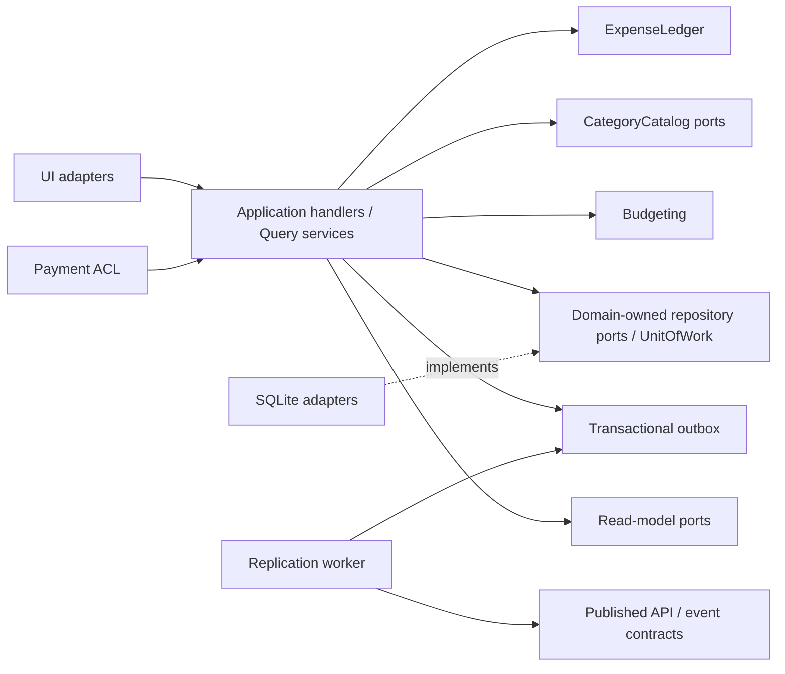

# 共通アーキテクチャ: ドメインと契約

- **バージョン**: v1.0.0
- **ステータス**: done
- **更新日**: 2026-11-01（JST）


対応要求: [REQ/ARCH-01](../req/REQ.md#arch-01-ドメインモデルと契約による設計)。採用判断は[ADR-0002](../adr/0002-domain-contract-design.md)。本書はLayer 2の共通方針で、[SPEC一覧](SPEC.md)と各機能の契約が設計の正本。

## 1. 設計方法と正本

DDDで業務責務・用語・整合性境界を定め、契約駆動設計で境界の振る舞いを実装前に固定する。契約駆動は公開DTO・Port・API・イベントのcontract-firstと、事前条件・事後条件・不変条件を検証するdesign by contractを含む。単にクラスをdomainフォルダへ移すことや、HTTPスキーマだけを作ることを完了条件にしない。

ドメインの意味と不変条件は本書・各機能書、操作の意味は機能書の契約表、HTTPの形式は[OpenAPI](contracts/openapi.json)、イベントの形式は[イベントスキーマ](contracts/events.schema.json)、共通DTOの制約は[共通スキーマ](contracts/shared.schema.json)を正本とする。異なる正本間の矛盾は変更を止めて同じレビューで修正する。業務ルールをスキーマ検証だけに委ねない。

## 2. 境界づけられたコンテキストと機能対応

| コンテキスト/機能の種類 | 対象機能 | 所有するモデル・責務 |
| :--- | :--- | :--- |
| ExpenseLedger（中核） | 手動支出、日次、履歴 | Expense集約、記録・変更・削除・復元、日次/月次の読み取りモデル |
| CategoryCatalog（支援） | カテゴリ | CategoryCatalog集約。名称の一意性・順序・未分類保護 |
| Budgeting（支援） | 予算 | BudgetPlan集約とAllocationエンティティ、BudgetPeriod・予算計算・通知閾値判定 |
| PaymentIntegration（統合） | 外部決済 | 外部DTOの腐敗防止層。正規化・分類、台帳の取り込み契約を呼ぶ |
| Replication（技術的支援） | 同期 | OutboxChangeとSyncSessionプロセスマネージャ、wire DTO・競合・ack・カーソル |
| PresentationPolicy（技術的能力） | 共通UI | WindowContext・LayoutDecision・NavigationState。業務集約を所有しない |
| BrandAssets（技術的能力） | アイコン | IconManifest・AssetSpecとビルド時検査。業務集約を所有しない |

9機能の一覧単位は維持するが、機能数とコンテキスト数を一致させない。日次・履歴にExpenseのコピー集約を作らず、ReadModelとして同じ台帳から射影する。



コンテキスト間はID、契約DTO、公開Portで結び、他コンテキストのEntityやDBテーブルを直接変更しない。`RetireCategory`だけは既存REQの即時整合を満たすため、アプリケーションの調整役が台帳・カテゴリ・予算のPortを同じローカルUnitOfWorkへ参加させる。分散トランザクションを導入する判断ではない。

## 3. ユビキタス言語・値オブジェクト

| 型 | 意味と制約 |
| :--- | :--- |
| ExpenseId / CategoryId / OwnerId | 空でない識別子。新規業務IDはUUID、既存の固定カテゴリIDを保持 |
| MoneyJPY | 支出は1〜99,999,999の整数。残額・集計は別型SignedYen/TotalYenで負値や単一明細上限超過を表現し、集計に支出上限を流用しない |
| AllocationYen | 0〜99,999,999の整数。配分合計超過はWarningで、BudgetPlanの不変条件違反にはしない |
| Memo | trim・改行の空白化後100grapheme以内、空値は内部None/通信null |
| CategoryName | trim後1〜20grapheme、NFKC・lowercase後のキーで同名を判定。元の表示名は保持する |
| SearchText / MerchantKey | NFKC・lowercase・trim。検索と取り込みの比較用であり、表示名を置き換えない |
| SpentAt / Instant | UTCミリ秒で保持。支出のローカル日付は1970-01-01以降。端末TimeZoneを注入し、日次は[start,nextStart) |
| CalendarMonth / BudgetPeriod | 前者は暦月、後者は開始日1〜28を基準とした家計期間。相互に代用しない |
| AggregateVersion | 正の整数、集約単位でCASする版。updatedAtやOutboxRevisionと区別し、削除後も版メタデータを保持 |
| UpdateStamp / OutboxRevision | 前者はレプリカのLWW用UTC時刻、後者は端末内送信単位の整数。revisionを別端末の集約版と比較しない |
| UndoGrant | 対象ID・削除版・元明細・期限を持つプロセス内許可。削除後5秒未満、同じ削除版、未使用の場合のみ復元可能。再起動で失効 |

CategoryNameとSearchTextは型と用途を分離し、いずれもNFKC・lowercase・trimを用いる。全9機能のデータ制約はREQを上位とし、既存名の読み替え・移行ではIDと明細を失わない。

## 4. レイヤー・依存方向・配置

```text
lib/features/<context>/
  domain/          # aggregates, value_objects, policies, repository_ports
  application/     # command/query DTO, handlers, UnitOfWork coordination
  infrastructure/  # drift, HTTP, SDK, native adapter, DTO mapper
  presentation/    # Flutter widgets, Riverpod controllers, view models
```

DomainはDart標準型と自コンテキストの抽象型だけへ依存し、Flutter・Riverpod・drift・HTTP・SharedPreferences・通知SDKをimportしない。ApplicationはDomainとPortを利用し、具象DBをnewしない。InfrastructureがPortを実装し、Composition RootのProviderで注入する。表示はApplicationへ依存し、SQLのselect/updateや外部HTTPを直接呼ばない。

既存featureディレクトリは一括移動せず段階的に移行してよいが、依存方向は守る。`ExpenseRepository`等の名前はDomain所有のPortを意味し、driftをimportする具象実装は`DriftExpenseRepository`等とする。ReadModelは専用QueryPortで効率よく結合・集計してよく、読み取りのために全Aggregateを復元しない。

## 5. 契約の共通規則

全契約IDは`<機能略号>-Cnn`、契約版は1.0.0。各表は入力/出力、事前条件、事後条件、不変条件/副作用の範囲、失敗、冪等性を含む。入力型の詳細は機能書、wire形式はスキーマへ対応付ける。

- `Result<T>` = Success(value, aggregateVersion?, warnings[]) または Failure(code, field?, retryable)。UI文言・例外スタックを公開契約に含めない。
- ValidationFailed=400/再試行不可、NotFound=404/再取得が必要、VersionConflict=409/最新版再取得、InvariantViolation=400/入力訂正、Busy=409/待機再試行、StorageFailure=500/同じIDで再試行、TransportFailure=503/接続後再試行、UndoExpired=400。HTTP以外も同じコード意味を用いる。
- precondition違反は公開境界でResultへ変換し、リリース時に無効化されるassertへ依存しない。値オブジェクトと集約でも不変条件を保護する。
- ローカル更新は集約版の比較→状態遷移→集約/版/DomainEventOutbox/SyncOutboxと読み取り世代を同じUnitOfWorkでcommitする。commit前の失敗は業務状態・版・Outboxを変更せず、イベントも通知も発行しない。通知のような外部副作用はcommit後に実行する。
- 再試行は同じ業務ID/入力/expectedVersionを使う。同じ値が適用済みならAlreadyAppliedを成功として返し、別値ならVersionConflict。成功イベントの二重追加をしない。削除の再送はAlreadyDeletedで、UndoGrantを再発行しない。
- Queryは業務状態・版・Outboxを変更しない。画面の選択状態やキャッシュだけを更新してよい。失敗を空集合へ変換しない。
- 同期は例外的に段階的commitを持つ。ACK済みの送信revisionや適用済みページは残してよいが、全ページ成功までカーソル・lastSuccessを進めない。古いACKで新revisionを削除しない。

## 6. 集約間整合・イベント・Port

`LedgerCommitPort`、`CatalogCommitPort`、`BudgetCommitPort`は`UnitOfWork.run`へ参加し、同じローカルDBで原子的にcommitできる。CategoryLookupは同じスナップショットでカテゴリの存在/版を検証する。カテゴリ削除と同時の支出保存はカタログ版のCASでどちらかを再取得にする。

保存後にExpenseRecorded/ExpenseChanged/ExpenseDeleted/ExpenseRestored、CatalogChanged/CategoryRetired、BudgetPlanChangedを発行する。イベントenvelopeはeventId・eventType・schemaVersion・aggregateId・aggregateVersion・occurredAt・payload。eventIdは集約ID/版/種類から一意に生成し、原子的保存済みのDomainEventOutboxだけを配送する。DomainEventOutboxはeventIdで追記し、状態同期用SyncOutboxのキー単位coalesceとは分離する。配送はat-least-once、副作用を持つconsumerはeventIdまたは処理済み集約版/期間閾値receiptで永続的に重複排除する。状態を全件再取得するUI射影は同じ版の再取得を同値へ収束させる。UI射影は再取得できるため失敗時に台帳を巻き戻さない。

外部の決済DTOはPayment ACLで検証・変換し、rawPayloadを台帳へ保存しない。外部イベントは公開イベントではなくInput DTOであり、envelopeへそのまま流用しない。同期wireのLWWデータと内部ドメインイベントも別契約とする。

## 7. DB・API・UIとの対応

既存のSQLiteテーブルはInfrastructureの保存形式で、集約やDTOそのものではない。[共通データモデル](SPEC.md#共通データモデル目標スキーマ版3)で物理対応を管理する。`AggregateVersions(context,aggregateId,version,updatedAt)`を追加し、Expense・CategoryCatalog・BudgetPlanの版を原子的に更新する。Expenseを物理削除しても対応版は保持し、古い編集/復元を検出する。

今回の設計目標はDB版3。作業途中の版2が存在し得るため、版1→2の既存移行を保持してから版2→3で集約版・DomainEventOutbox・ReadProjectionStateを追加する。版2の明細は版1で初期化せず、各既存集約をversion=1として登録する。移行失敗時は全体を戻し、再起動で再試行できること。

UIはDTO/ViewModelを描画し、成功時だけ閉じる・遷移する。機能固有のSnapshotMismatch・UnsupportedSource・AssetMissing等は各契約表のResultコードとし、HTTP境界では公開ErrorスキーマのValidationFailed等へ明示的に変換する。

VersionConflictは入力を保持して最新版確認へ誘導する。既存8画面の配置・金額/期間/検索/閾値600/840は維持し、コンポーネント仕様に対応契約IDを記載する。

## 8. 契約の進化と検証

内部契約・イベントは意味的バージョンで管理する。必須項目追加、意味・エラー/不変条件・冪等性の変更は破壊的変更としてmajorを上げ、同じ契約IDの改訂履歴と対応consumerを記録する。wireはschema_version=2を維持し、現行v1互換の読み替えはACLだけに置く。DB版3とwire版2は別の版管理。

各Portのfake/SQLite/HTTP実装に同じprovider契約テストを実行する。consumerは送受信fixtureをスキーマ検証し、事前条件違反で副作用ゼロ、不変条件の境界、CAS競合、同一要求再送、タイムアウト/部分失敗を検証する。共通UI・アイコンも純粋関数/ビルド検査の入力と保証を契約テストする。計画・結果は[VERIFY](../verification/VERIFY.md)で管理し、文書のdoneを実装済み・テストPASSの証拠にしない。

### 読み取りスナップショットとイベント保存

`ReadProjectionState(projectionId,generation)`をローカルDBに置き、Ledger/Catalog/Budgetの関連更新・Replica適用と同じUnitOfWorkでgenerationを1進める。ReadModelは同じ読取トランザクションでデータとgenerationを取得し、snapshotIdを返す。HistoryCursorは条件指紋/generation/最後のキーを持つ。途中でgenerationが変わった場合はCursorInvalidatedを返し、UIが先頭から再取得・ID重複排除する。MAX(aggregateVersion)を全台帳の世代として代用しない。

`DomainEventOutbox(eventId,aggregateId,aggregateVersion,eventType,payloadJson,occurredAt,deliveryState)`は追記型。SyncOutboxは送信前の同一entityKeyを最新状態へ畳み込んでよいが、未配送のドメインイベントを上書きしない。ReplicaApplyはDomain不変条件と集約版を更新し、ReadProjectionStateを進め、読取再取得を通知する。同じ変更をSyncOutboxへ戻して通信ループを起こさない。

カテゴリ廃止のローカルCommandは単一DB取引。リモートproviderで大量の明細を複数取引で移行する場合は廃止プロセスを永続化し、明細移行・配分削除が完了するまでカテゴリtombstoneのACKを返さない。途中はカテゴリを参照可能なまま維持し、失敗後の再試行を冪等にする。ローカルの原子的保証を分散システム全体の原子的保証だと解釈しない。
